# Writer Agent Skills and Staged Workflow

This document provides an exhaustive description of how the Writer Agent’s new staged workflow and its associated skill files operate in Holosophus. It covers skill registry discoverability, relationship mapping, the sequence of execution, and the specific mechanics of selective skill loading.

---

## 1. Overview and Core Philosophy

Previously, the Writer Agent operated in a direct, one-pass generation mode, which often resulted in jumping immediately from raw evidence to producing a full LaTeX paper in a single step. This led to hallucinated results, generic text, and poor structural balance.

The **Staged Workflow** refactors the Writer Agent into a highly structured, step-by-step authoring pipeline. Rather than writing a full document at once, the agent operates in sequential stages:
1. **Evidence and context ingestion** (Read input files)
2. **Skeleton & Plan definition** (Establish paper budget, claims, and roadmap)
3. **Sequential Section Writing** (Compose paper section-by-step using narrow, focused domain skills)
4. **Section Self-Check & Repair** (Analyze drafted sections immediately and log unresolved gaps)
5. **Full Assembly and Global Checking** (Synthesize paper parts, check global claim consistency, and repair issues)
6. **Compilation and Validation** (Recompile, resolve bibliography keys, and verify references)

---

## 2. Skill Registry & Discoverability

All Writer skills are registered in a central registry:
- **Registry Location**: [`holosophos/holosophos/skills/writer/skills_registry.yaml`](../holosophos/holosophos/skills/writer/skills_registry.yaml)

The agent references this registry at startup and dynamically discovers/loads skills depending on the task type (full-paper vs. local edits) and current writing stage. Each skill is mapped to its file path, has descriptive metadata, and has specific triggering keywords.

### Registry Schema Example
```yaml
  - id: skeleton_planner
    path: holosophos/holosophos/skills/writer/skeleton_planner.md
    description: "Build a structured paper skeleton before writing any section content. Defines skeleton fields, argument flow, evidence planning, and page budget."
    triggers:
      - skeleton
      - paper plan
      - paper outline
```

---

## 3. Core (General) Skills vs. Section-Specific Skills

Skills are split into two categories:

### A. General Skills & Quality Gates
- **`paper_standard.md`**: Default standard for a complete, evidence-based paper with the requested scope and length. **`a_star_conference_paper.md`** is optional for an explicitly requested conference submission.
- **`skeleton_planner.md`**: Guides the generation of the structured paper skeleton (`paper_skeleton.md`).
- **`section_self_check.md`**: Formulates the internal quality criteria applied immediately after drafting any individual section.
- **`global_writer_check.md`**: Defines criteria for full-paper coherence, claim alignment, baseline fairness, and transition checks.

### B. Section-Specific Writing Skills
Each major section of an academic ML/AI paper has its own dedicated skill file. These are loaded *one at a time* during the sequential writing stage:
- `abstract_writer.md`
- `introduction_writer.md`
- `related_work_writer.md`
- `method_writer.md`
- `experimental_setup_writer.md`
- `results_writer.md`
- `analysis_ablations_writer.md`
- `limitations_writer.md`
- `ethics_broader_impact_writer.md`
- `conclusion_writer.md`
- `appendix_writer.md`

---

## 4. The Staged Workflow Pipeline (How the Agent Calls Them)

The following diagram illustrates the relationship between input context, active skills at each stage, generated state, quality gates, and final output files.

```mermaid
flowchart TD
    subgraph Input ["1. Ingestion Stage"]
        inputContext["Raw Data, Evidence, and Instructions"]
    end

    subgraph SkeletonStage ["2. Planning Stage"]
        loadPlanner["Load skeleton_planner.md<br>& paper_standard.md"]
        buildSkeleton["Draft Paper Skeleton"]
        saveSkeleton["Save paper_skeleton.md<br>(Observability Artifact)"]
    end

    subgraph DraftingLoop ["3. Sequential Drafting Stage"]
        selectSection{"Get Next Section"}
        loadSectionSkill["Load section_specific_writer.md<br>& paper_standard.md"]
        readContext["Load paper_skeleton.md<br>& Prior Sections (Read-Only)"]
        writeSection["Draft Target Section<br>(In-Memory Draft State)"]

        loadSelfCheck["Load section_self_check.md"]
        runSelfCheck["Execute Quality Gate Checks"]
        repairGate{"Can we fix now?"}
        reviseNow["Revise Section Immediately"]
        logTodo["Record TODO / Placeholder<br>in Paper State"]
        updateState["Update Paper State<br>(unresolved TODOs, claims, evidence)"]
    end

    subgraph AssemblyStage ["4. Assembly & Global Pass"]
        assembleTex["Assemble Full LaTeX Draft<br>(paper.tex)"]
        loadGlobalCheck["Load global_writer_check.md"]
        runGlobalCheck["Execute Global Coherence & Alignment Pass"]
        globalRepairGate{"Are there fixable<br>global issues?"}
        repairGlobal["Repair Transitions, Calibrate language"]
        keepTodos["Finalize unresolved TODOs<br>(No Hallucinations Allowed)"]
    end

    subgraph Output ["5. Compilation & Finalization"]
        latexPipeline["Run compile_latex & verify_references"]
        finalArtifacts["Output Files:<br>- paper.tex<br>- references.bib<br>- paper.pdf<br>- Final Answer Path"]
    end

    %% Execution Flows
    inputContext --> loadPlanner
    loadPlanner --> buildSkeleton
    buildSkeleton --> saveSkeleton
    saveSkeleton --> selectSection

    selectSection --> loadSectionSkill
    loadSectionSkill --> readContext
    readContext --> writeSection
    writeSection --> loadSelfCheck
    loadSelfCheck --> runSelfCheck
    runSelfCheck --> repairGate

    repairGate -->|Yes| reviseNow
    repairGate -->|No| logTodo
    reviseNow --> updateState
    logTodo --> updateState

    updateState -->|More Sections| selectSection
    updateState -->|All Drafted| assembleTex

    assembleTex --> loadGlobalCheck
    loadGlobalCheck --> runGlobalCheck
    runGlobalCheck --> globalRepairGate

    globalRepairGate -->|Yes| repairGlobal
    globalRepairGate -->|No| keepTodos
    repairGlobal --> latexPipeline
    keepTodos --> latexPipeline

    latexPipeline --> finalArtifacts
```



---

## 5. Detailed Stage Mechanics

### Stage 1: Ingestion & Target Classification
When invoked with a task, the Writer Agent reads the input payload.
- **Classification Rule**:
  - If the task is classified as a **Full-Paper Writing Task** (e.g., "write an A* paper", "turn this project into a paper"), the agent **must** trigger the Staged Workflow.
  - If the task is classified as a **Local/Maintenance Task** (e.g., "fix compile error", "edit Related Work section"), the agent skips the stages and modifies the requested section directly.

### Stage 2: Planning and Skeleton Creation
- **Skills Loaded**: `skeleton_planner.md` and `paper_standard.md`. Add the conference standard only for an explicit venue request.
- **Output**: Writes `paper_skeleton.md` containing:
  - working title, target venue, central claim, problem, gap, main idea, and contributions.
  - An explicit map of planned sections, page budgets, required evidence, appendix plans, and reviewer risks.
- **Why**: This pins down the scientific claim and prevents the agent from changing the method's core definition as it writes different sections.

### Stage 3: Sequential Section Writing & Read-Only Contexts
Sections are drafted in order: *Abstract → Introduction → Related Work → Method → Experimental Setup → Results → Analysis → Limitations → Ethics → Conclusion → References → Appendix*.

To avoid overloading the LLM’s context and prevent recursive rewrites, context boundaries are strictly defined:
- **Active Section Skill**: Only *one* section-specific skill is loaded at any given moment (e.g., `method_writer.md` is loaded *only* when drafting Method).
- **Previous Sections (Read-Only)**: The agent accesses previous sections for terminology alignment and flow, but **is forbidden from modifying them**. If a mistake is spotted in an earlier section (e.g., Related Work uses different terminology), the agent records a "consistency note" in the paper state instead of editing the file.
- **Relevance Policy**:
  - `Experimental Setup` may look back at `Method`.
  - `Results` may look back at `Experimental Setup` and `Method`.
  - `Limitations` may look back at `Results` and `Method`.

### Stage 4: Section Self-Check Quality Gate
- **Skill Loaded**: `section_self_check.md`
- **Action**: Immediately after writing, the agent performs a checklist verification.
  - If a gap is identified (e.g., missing learning rate or baseline numbers) and the information is **not in the context**, the agent **must not invent** it. It instead inserts an explicit placeholder: `TODO: [Add X once evaluation is available]`.
  - If the gap is fixable, it rewrites the section immediately.

### Stage 5: Assembly and Global Check
- **Skill Loaded**: `global_writer_check.md`
- **Action**: Once all sections are complete, the agent merges them into the canonical LaTeX source (`paper.tex`). It executes a global coherence check verifying:
  - Central claim consistency.
  - Contribution-to-evidence alignment (verifying that every contribution listed in the introduction has corresponding experiments/results).
  - Transition smoothness between chapters.
  - Calibrated language enforcement (ensures phrases like "state-of-the-art" are stripped unless heavily backed by evidence).

### Stage 6: Finalization & Reference Verification
- **Action**: The agent runs `compile_latex` and `verify_references`. If references don't resolve, it repairs `references.bib` and re-runs the compiler to produce a compiling PDF.

---

## 6. Hard Anti-Hallucination Invariants

All skill files and prompt layers enforce these hard constraints:
- **No Invented Metrics/Numbers**: The Writer Agent may NOT hallucinate a single percentage improvement, baseline score, or hyperparameter value. If the experiments do not mention it, it remains a `TODO` placeholder.
- **Calibrated Claim Strengths**:
  - *No evidence*: Must remove the claim or write: "Evidence is not yet available."
  - *Weak evidence*: Use phrases like "suggests", "indicates", "is consistent with".
  - *Moderate evidence*: "shows in this setting", "improves over the tested baselines".
  - *Strong evidence*: "consistently improves across datasets, seeds, and ablations".
- **Zero Hallucinated Citations**: Every citation key in `\cite{...}` must exist in `references.bib` and be verifiable. If a citation cannot be found, it is treated as a validation failure.
