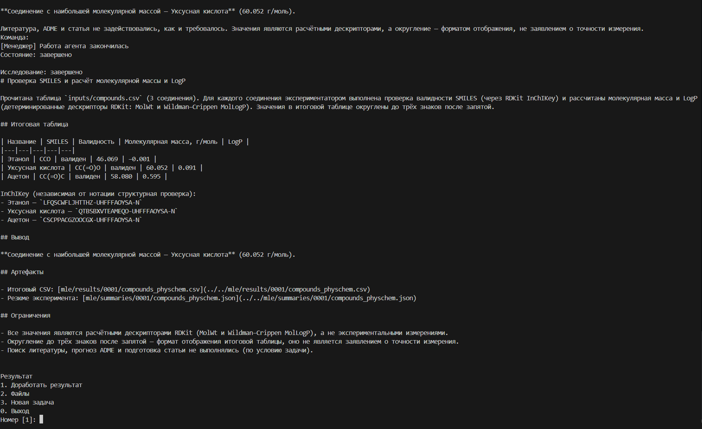

# AI Researcher — консольный прототип

Прототип виртуальной лаборатории с управлением из терминала. Пользователь
задаёт исследовательскую задачу и прикладывает файлы, а менеджер привлекает
агентов для поиска литературы, выдвижения гипотез, вычислений, подготовки
статьи и рецензирования. Состав этапов зависит от задания.

Доступны профили **«Компьютерные науки»** и **«Химия»**, согласование источников
и плана, наблюдение за сообщениями агентов, управление запуском и доработка
результата. Claude Code используется как среда выполнения агентов.
Поддерживаются модели Anthropic и другие модели с совместимым API,
настроенные в конфигурации, в том числе развернутые в собственной инфраструктуре.



## Запуск

Нужны Linux или WSL, Python 3.12+, uv, Make, Docker с Compose 2.24.4+
и Claude Code CLI. Для чтения PDF на хосте нужен пакет `poppler-utils`.

```bash
git clone https://github.com/irtez/ai-researcher-prototype.git
cd ai-researcher-prototype/Holosophus
cp .env_example .env
uv sync --locked
```

Перед запуском отредактируйте `.env`:

- Для Claude авторизуйте CLI через `claude auth login`. Для DeepSeek задайте
  `DEEPSEEK_API_KEY`. Другие подключения описываются в `config/models.yaml`.
- Ключи инструментов, например `OPENROUTER_API_KEY` и `TAVILY_API_KEY`,
  задаются отдельно в зависимости от используемых сервисов.
- Для локальной работы без SSH задайте `CLOUDRU_SSH_KEY_HOST_PATH=/dev/null`
  и `SELECTEL_SSH_KEY_HOST_PATH=/dev/null`. `LOCAL_GPU_DEVICES` можно оставить
  пустым для вычислений на CPU.
- Оставьте `CC_DEMO_FIXED_LAUNCH=0`, чтобы применялся выбор модели в консоли.

Соберите образ исполнителя и запустите сервисы:

```bash
make executor-image
make console-services
```

В первом терминале запустите сервер исследований:

```bash
make console-runner
```

Во втором терминале, из того же каталога `Holosophus/`, откройте клиент:

```bash
make prototype-console
```

Сервисы инструментов и файлов работают в Docker, сервер исследований и
консольный клиент — на хосте. Веб-интерфейс при таком запуске не требуется.
Используются локальные порты 5056–5065. Настройка трассировки и дополнительные
параметры приведены в [инструкции запуска](Holosophus/docs/operations/console-prototype.md).

## Как пользоваться

1. Выберите профиль, модель, уровень рассуждений, место вычислений и согласования.
   Для первого запуска выберите **«Локально»**. Удалённый режим требует настройки узла.
2. Введите задание. Завершите ввод строкой `/send`.
3. Добавьте вложения: путь к каждому файлу вводится на отдельной строке.
   Пустая строка завершает список. Поддерживаются CSV, XLS/XLSX, DOCX,
   JSON/JSONL, PDF и изображения PNG/JPEG до 20 Мбайт на файл.
4. Подтвердите запуск. В консоли появятся сообщения агентов и вызовы инструментов.
   При согласовании `1` подтверждает документ, `2` позволяет направить замечание,
   `3` останавливает исследование.
5. После завершения можно скачать файлы или отправить задачу на доработку.

Во время работы доступны `/pause`, `/resume`, `/steer текст`, `/stop`
(остановка с сохранением) и `/cancel` (немедленная остановка).
Команда `/exit` отключает клиент, сохраняя выполняющееся на сервере исследование.

```bash
# Список своих сессий
make prototype-console ARGS='--list'

# Повторное подключение
make prototype-console ARGS='--session research_идентификатор'
```

Результаты находятся в `Holosophus/workdir/`, скачанные через клиент файлы —
в `Holosophus/console-downloads/`. Сохраняйте каталог `.console-state/`:
он содержит идентификатор владельца сессий.

## Короткий пример со SMILES

```bash
make prototype-console ARGS='--prompt-file examples/console-smiles/task.txt'
```

Выберите **«Химия»**, настроенную модель и локальные вычисления. В качестве
вложения укажите `examples/console-smiles/molecules.csv`.
Задание включает проверку SMILES, поиск дубликатов, расчёт молекулярной массы
и LogP и сохранение таблиц в CSV. В файле восемь записей, среди которых есть
разные записи одинаковых молекул и ошибочная структура.

## Исходный код

- `Holosophus/scripts/prototype_console.py`, `Holosophus/scripts/console_client/` — клиент.
- `Holosophus/scripts/cc_runner.py`, `Holosophus/scripts/run_research.py` — управление исследованиями.
- `Holosophus/config/` — модели и подключение инструментов.
- `Holosophus/holosophos/`, `Holosophus/academia_mcp/`, `Holosophus/mle_kit_mcp/`,
  `Holosophus/chem_mcp/`, `Holosophus/chem_conversions_mcp/` — ядро, агенты и инструменты.

В репозитории сохранены общие компоненты приложения и конфигурации сборки.
Основная точка входа этого прототипа — `make prototype-console`.
